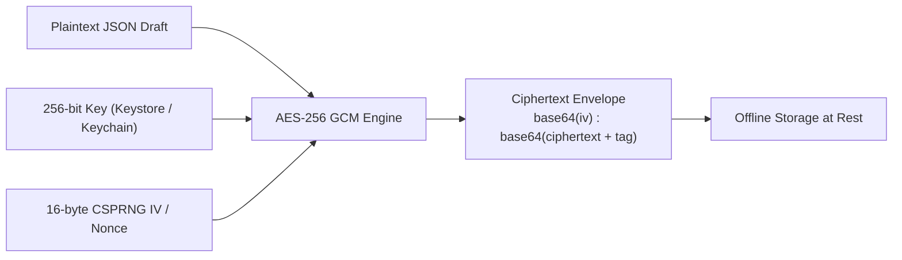
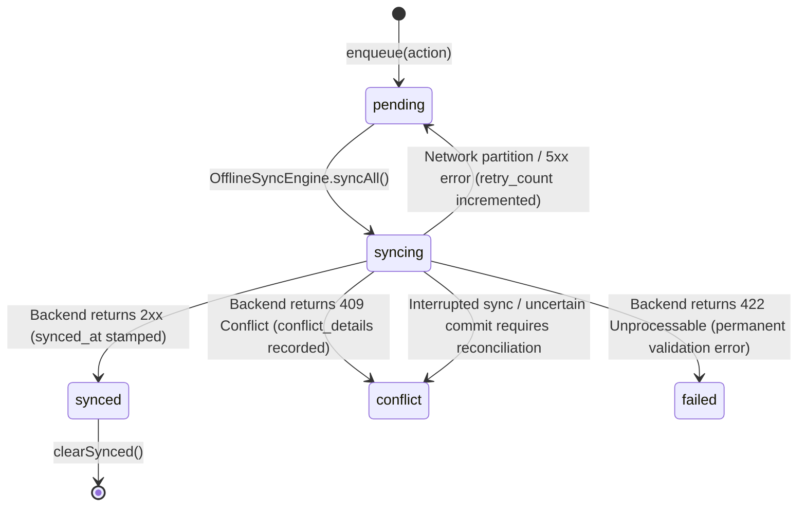

# Architecture Specification — Flutter Offline Mutation Queue & Encryption Scaffolding (USYD-T0081)

**Status:** APPROVED  
**Author:** Senior Flutter Engineer (Ahmed Mamdouh El-Sayed) & Principal Software Architect  
**Date:** November 2026  
**Context:** Usayd Academy Mobile App & Sprint S01  
**Target Repository:** `usayd-flutter`  

---

## 1. Architectural Vision: Local-First Educational Experience

Learners frequently interact with Usayd Academy in environments with intermittent, low-bandwidth, or offline mobile connectivity (e.g. commuting, rural areas, or during focused recitation practice).

A pure online-only architecture causes lost user work, failed lesson submissions, and user frustration. Conversely, naive optimistic local commits without server validation introduce data inconsistency and phantom states.

### Core Principles:
1. **Never Fake Server Commit:**  
   Local actions are stored explicitly as `pending` or local drafts. An action or recitation submission is ONLY marked as `synced` when the authoritative Laravel 13 backend responds with HTTP 200/201/204.
2. **Hardware-Backed AES-256 GCM Encryption at Rest:**  
   All local drafts and queued mutations containing student work, evaluation notes, or profile metadata are encrypted at rest using AES-256 GCM. The 256-bit cryptographic key is securely stored in hardware-backed platform Keystore (Android) / Keychain (iOS) via `flutter_secure_storage`.
3. **Strict FIFO Queue Ordering:**  
   Mutations are executed strictly in the order they occurred (`createdAt` timestamp order).
4. **First-Class Conflict Recognition (409 Conflict):**  
   If the remote server reports a conflict (HTTP 409 Conflict), the action is flagged as `conflict` and retained for user/educator resolution, rather than silently overwritten or discarded.

---

## 2. Cryptographic Scaffolding (`AesGcmEncryptionService`)

- **Algorithm:** AES-256 GCM (`enc.AESMode.gcm`).
- **Key Generation:** 32 cryptographically secure random bytes generated on first launch and preserved in `FlutterSecureStorage`.
- **IV/Nonce:** 16 cryptographically secure random bytes generated uniquely per encryption invocation.
- **Envelope Format:** `base64(iv):base64(ciphertext + 128-bit GCM authentication tag)`.
- **Tamper Protection:** Any bit manipulation of the ciphertext or tag causes GCM authentication failure and throws `DecryptionException`.

---

## 3. Offline Action Lifecycle & State Machine

### State Definitions:
- **`pending`**: Mutation saved locally in encrypted storage, awaiting sync.
- **`syncing`**: In-flight HTTP request being processed by `ApiClient`.
- **`synced`**: Authenticated backend accepted mutation; timestamp recorded.
- **`conflict`**: State divergence detected. Requires learner or teacher intervention.
- **`failed`**: Request permanently rejected (e.g. invalid payload schema).

---

## 4. Deduplication & Idempotency Guarantees

Every `OfflineAction` carries an `idempotencyKey`. When `enqueue` is called:
1. `OfflineActionQueue` inspects existing pending/stored actions.
2. If an action matching the `idempotencyKey` already exists, it returns the existing record without appending a duplicate.
3. During sync dispatch, `OfflineSyncEngine` passes `Idempotency-Key: <key>` header to the Laravel API, aligning directly with `App\Http\Middleware\EnforceIdempotency`.

---

## 5. UI Presentation & Age-Adaptive Display

The `OfflineSyncIndicator` widget adheres to Usayd Design Tokens:
- **Pending:** Brass pill indicator showing count and "Sync Now" tap target.
- **In Progress:** Oasis green banner with circular loading spinner and localized Arabic status («جاري مزامنة التغييرات المحفوظة محلياً...»).
- **Conflict:** Crimson warning banner with alert icon indicating divergence requiring review.
